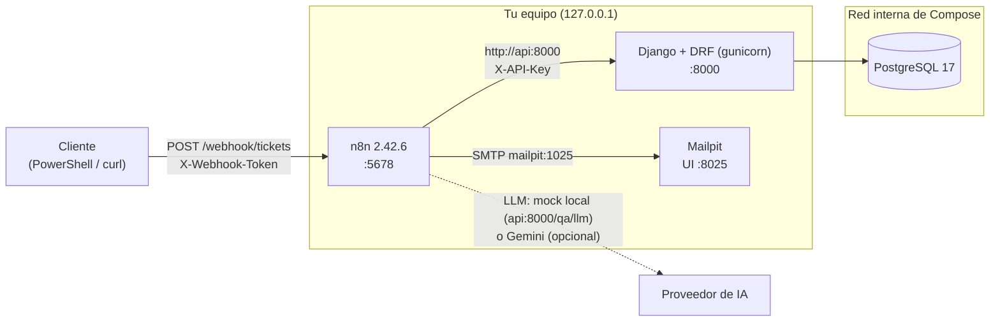
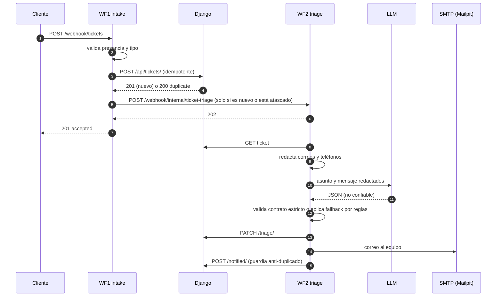
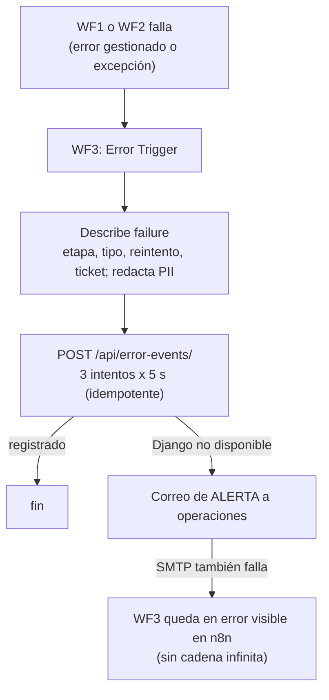

# Arquitectura

## Visión general

Cuatro contenedores en una red de Docker Compose. Solo tres puertos salen al equipo, todos enlazados a `127.0.0.1`.

| Servicio | Imagen | Rol | Datos |
|---|---|---|---|
| `n8n` | `n8nio/n8n:2.42.6` | Orquesta los 3 workflows | SQLite en el volumen `n8n_data` (workflows, credenciales cifradas, historial) |
| `api` | construida desde `backend/` (Python 3.13, Django 5.2 LTS, DRF 3.18) | Persiste tickets y eventos de error; fuente de verdad de las reglas de negocio | — |
| `postgres` | `postgres:17-alpine` | Base de datos de la API | Volumen `postgres_data` |
| `mailpit` | `axllent/mailpit:v1.31.4` | Servidor SMTP de pruebas con interfaz y API HTTP; **nunca entrega correo real** | Efímero (sin volumen) |

PostgreSQL (5432) y el SMTP (1025) **no se publican**: solo son alcanzables dentro de la red de Compose.

## Los tres workflows

Están escritos como código (`n8n/src/workflows/*.js`) y se generan a `n8n/workflows/*.json`. `scripts\build-workflows.ps1 -Check` falla si el JSON se desvía del código.

| # | Workflow | Nodos | Disparador | Tiempo máx. |
|---|---|---|---|---|
| WF1 | `01 - Ticket intake` | 13 | Webhook público `POST /webhook/tickets` (token) | 45 s |
| WF2 | `02 - AI triage and notification` | 22 | Webhook interno `POST /webhook/internal/ticket-triage` (otro token) | 90 s |
| WF3 | `03 - Error monitoring` | 5 | *Error Trigger* (error workflow de WF1 y WF2) | 80 s |

### Flujo normal

### Flujo de error

Detalle de cada workflow: [`api.md`](api.md) (WF1), [`wf02-ai-triage.md`](wf02-ai-triage.md), [`wf03-error-monitoring.md`](wf03-error-monitoring.md).

## Modelo de datos (PostgreSQL, gestionado por Django)

- **Ticket**: `external_id` (**UNIQUE**, clave de idempotencia), `customer_email`, `subject`, `message`, `source` (`web|email|api`), `status` (`received → triaged → notified`, nunca retrocede), `category`, `priority`, `summary` (≤ 280), `triage_source` (`ai|fallback`), `triage_reason`, `triaged_at`, `notified_at`, `created_at`.
- **ErrorEvent**: `workflow_id`, `workflow_name`, `execution_id`, `failed_node`, `error_type`, `retryable` (`yes|no|manual`), `message` (corto y redactado), `ticket_id`, `ticket_external_id`, `created_at`. **UNIQUE** `(workflow_id, execution_id)`: registrar dos veces el mismo fallo no duplica.

## Decisiones de diseño y alternativas descartadas

| Decisión | Alternativa descartada | Motivo |
|---|---|---|
| WF1 → WF2 por **webhook interno** (con su propio token) | *Execute Workflow* | Cada ejecución queda separada, con su propio historial y su propio *error workflow*; se puede probar y **reprocesar a mano** con una sola petición |
| WF3 es un **workflow aparte** con *Error Trigger* | Manejo de errores dentro de cada workflow | Es el mecanismo nativo de n8n y centraliza el registro; tiene su propia protección contra bucles |
| **Basic LLM Chain** + nodo *Code* de validación propia | *Information Extractor* / *Text Classifier* | Dependen de llamadas a herramientas del proveedor (difícil de simular y de variar). Con un prompt JSON y validación propia, la salida del modelo **nunca se usa sin comprobar** |
| Un solo nodo de chat compatible con OpenAI y **URL base configurable** | Un nodo por proveedor | Mock local y Gemini se cambian solo con la credencial (`LLM_PROVIDER`) |
| La IA no elige destinatarios, URLs ni acciones | Dejar al modelo componer el correo | Una inyección de instrucciones no puede desviar correos (probado, T08b/T10b) |
| Validación en **dos capas** (borde en n8n + reglas en Django) | Solo una | Fallo rápido en el borde y una API que se protege a sí misma; Django es la fuente de verdad |
| Idempotencia por `external_id` en la **base de datos** (`UNIQUE` + `get_or_create`) | Comprobar en el workflow | Es la única forma segura frente a peticiones simultáneas (probado con 5 en paralelo) |
| **Sin reintento automático** al crear el ticket | Reintentar el `POST` | Si expira pero Django termina, el reintento recibiría `duplicate` y WF2 no se lanzaría nunca. La idempotencia protege los datos, no el flujo; el ticket atascado (>120 s sin notificar) se reprocesa al reenviarlo |
| **Sin reintento automático** del correo | Reintentar el envío | Puede duplicar el correo. Se registra `retryable=manual` y se reprocesa a mano |
| Fallos de etapa **gestionados** que terminan la ejecución en error | Responder éxito y registrar aparte | No se disfraza un fallo de éxito, y WF3 siempre se entera. El mensaje viaja en hexadecimal porque n8n reescribe los mensajes que contienen ciertos códigos (`ECONNREFUSED`…) |
| n8n en **SQLite** con volumen | n8n sobre PostgreSQL | Menos piezas para un entorno local; PostgreSQL es la recomendación para producción |
| **Mailpit** | MailHog | Mantenido y con API HTTP para verificar entregas en los tests |
| Puertos solo en `127.0.0.1` | Publicar en todas las interfaces | El editor de n8n no debe exponerse; para exponerlo, solo `/webhook/*` tras un proxy con TLS |
| Protección **SSRF** de n8n activa, con `api` y `127.0.0.1/32` permitidos | Dejarla apagada (valor por defecto de 2.42) | Un workflow o un dato manipulado no puede alcanzar `postgres`, `mailpit` ni metadatos de nube (probado) |
| Workflows como **código** + JSON generado con detección de deriva | Editar solo en la interfaz | Revisable en Git, testeable por unidades y reproducible |

## Fronteras de confianza

1. **Cliente → n8n**: no confiable. Token obligatorio, límite de cuerpo de 1 MiB, validación estricta, campos desconocidos descartados.
2. **n8n → Django**: confiable por clave (`X-API-Key`, comparación en tiempo constante). Django revalida todo.
3. **n8n → LLM**: se envía lo mínimo (asunto y mensaje con correos y teléfonos redactados, nunca el correo del cliente). La respuesta **no es confiable**: se valida contra un contrato cerrado y, si no cumple, se declara el modo degradado.
4. **Registros y alertas**: ids, etapa, tipo y un detalle corto y redactado; nunca el payload ni claves.

Controles y riesgos aceptados: [`security.md`](security.md).

## Fuera de alcance (a propósito)

Autenticación de usuarios finales, panel de tickets, adjuntos, multi-idioma, TLS, alta disponibilidad, n8n en modo cola y SMTP real. Ver *Mejoras futuras* en el [README](../README.md).
